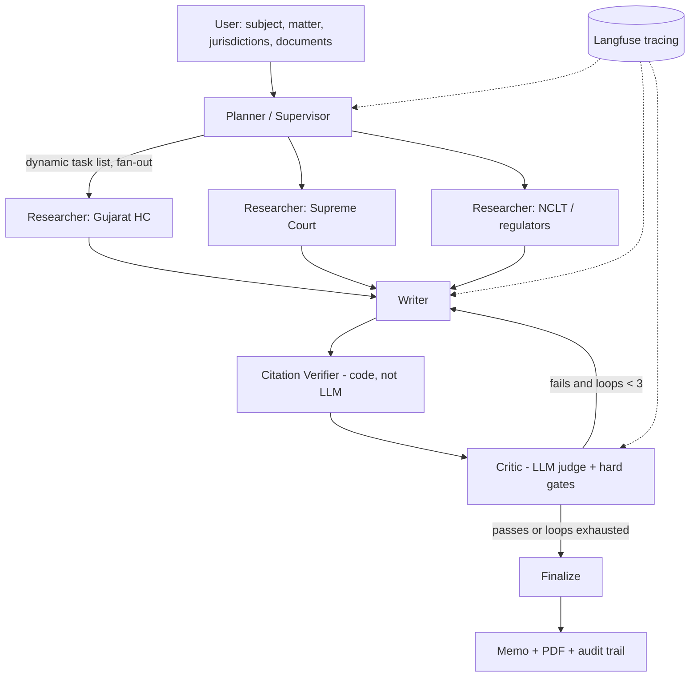

# ⚖️ Legal Due-Diligence Memo Writer (India)

A multi-agent system that researches an Indian legal due-diligence question across several
jurisdictions in parallel, drafts a memo, **verifies every cited case against a real legal
source**, and loops until the memo clears a defined quality bar. Built with LangGraph, Groq,
Tavily and Streamlit.

> **Why it exists:** lawyers have been sanctioned for filing briefs with hallucinated citations.
> The citation-verification step is the core of this project, not polish.

## Architecture



| Agent | Job |
|---|---|
| Planner | Creates one research task per jurisdiction (dynamic task list) |
| Researchers (parallel) | Search trusted Indian legal domains, return only source-backed points |
| Writer | Drafts the memo; every fact carries a source id; cited cases must appear in a source |
| Verifier | **Deterministic code**: checks each case against its source and an independent lookup |
| Critic | LLM-as-judge, rubric: completeness, legal accuracy, citation coverage (1-5 each) |

### How a citation is verified
1. The cited source must have been **actually retrieved** this run.
2. It must come from a **trusted legal domain** (`config.INDIAN_LEGAL_DOMAINS`), not a blog or an upload.
3. The case name must **appear in that source** (word-overlap score ≥ 70%).
4. An **independent lookup** (Indian Kanoon API if configured, otherwise Tavily on trusted domains)
   must return a result whose title matches.

Result per case: `verified`, `unverified` (grounded but not confirmed) or `failed` (hallucination).
A memo is **APPROVED** only if all cases are verified, every fact has a real source, and the critic
average ≥ 4.0 with no dimension below 3. After 3 revisions it is marked **NEEDS HUMAN REVIEW**.

### Auditability
- The **Audit trail** tab / JSON lists each claim with the source URL(s) that support it.
- With Langfuse keys set, every agent run, prompt and output is traced for partner-level review.

## Quick start (local)

```bash
git clone <your-repo-url>
cd legal-memo-writer
python -m venv .venv
source .venv/bin/activate        # Windows: .venv\Scripts\activate
pip install -r requirements.txt
cp .env.example .env             # then paste your keys into .env
streamlit run app.py
```

Keys needed: **Groq** (free, console.groq.com) and **Tavily** (free tier, tavily.com).
Optional: Indian Kanoon API token, Langfuse keys. You can also paste keys in the app sidebar.

**First thing in the app:** click **"Load models available to my key"** in the sidebar and choose
models from the list. Groq changes its model catalogue often, so this avoids "model not found" errors.

Run without the UI: `python run_cli.py "ABC Industries Pvt Ltd" "Check litigation" "Gujarat High Court"`

Run the tests: `pip install pytest && pytest -q`

## Upload to GitHub

1. Create an empty repository on github.com (no README).
2. In this folder:
```bash
git init
git add .
git commit -m "Legal due-diligence memo writer"
git branch -M main
git remote add origin https://github.com/<you>/<repo>.git
git push -u origin main
```
`.env` is in `.gitignore`, so your keys are not uploaded. Never commit real keys.

## Deploy on Streamlit Community Cloud (free)
1. Push the repo to GitHub, then go to share.streamlit.io and create an app from it (main file: `app.py`).
2. In **Settings → Secrets** add:
```toml
GROQ_API_KEY = "..."
TAVILY_API_KEY = "..."
```
(Optional: `INDIANKANOON_API_TOKEN`, `LANGFUSE_PUBLIC_KEY`, `LANGFUSE_SECRET_KEY`, `LANGFUSE_HOST`.)

## Project structure

```
app.py                  Streamlit UI
run_cli.py              command-line runner
memo_writer/
  config.py             limits, trusted domains, model preferences
  state.py              Pydantic schemas + LangGraph state
  llm.py                Groq model + structured-output helper
  tools.py              Tavily / Indian Kanoon search, document text extraction
  planner.py            supervisor: dynamic task list
  researcher.py         parallel per-jurisdiction worker
  writer.py             memo drafting with source ids
  verifier.py           citation verification (no LLM)
  critic.py             LLM judge + hard gates
  graph.py              LangGraph wiring and reflection loop
  audit.py              claim -> source map
  pdf_export.py         PDF output
  tracing.py            Langfuse integration
tests/test_verifier.py  planted fake citations must be caught
```

## Known limitations (be upfront about these)
- Only **publicly searchable** sources. eCourts, MCA21, land records and many High Court portals
  use captchas/logins and are not queried directly. Absence of a result is **not** proof of no litigation.
- Verification confirms a case **exists and matches a source**; it does not prove the memo's legal
  reasoning is right. A lawyer must review every memo.
- Groq's free tier has token and rate limits: use 1-3 jurisdictions, or lower
  `MAX_SOURCES_PER_TASK` / `SNIPPET_CHARS` in `config.py`.
- Open models can be weaker at legal reasoning than frontier models. The pipeline's checks are
  there precisely because of that.
- The PDF uses a built-in font, so some characters (e.g. ₹) are replaced with text ("Rs.").
- Criminal-law references: BNS/BNSS/BSA replaced IPC/CrPC/Evidence Act from July 2024; the memo may
  cite either depending on the source.

## Troubleshooting
| Error | Fix |
|---|---|
| `model_not_found` / 404 | Click **Load models available to my key** and pick from the list |
| 429 / rate limit | Wait a minute, choose fewer jurisdictions, or a smaller model |
| `TAVILY_API_KEY` KeyError | Add the Tavily key in the sidebar or `.env` |
| Everything ends `NEEDS HUMAN REVIEW` | Expected when sources are thin; check the Citation checks tab for the reason |

## Roadmap
Indian Kanoon API as primary case source, statute-section verification against India Code,
Chroma store for uploaded documents, user login and investigation history.

*Not legal advice. Prepared with AI assistance; review by a qualified lawyer is required.*
