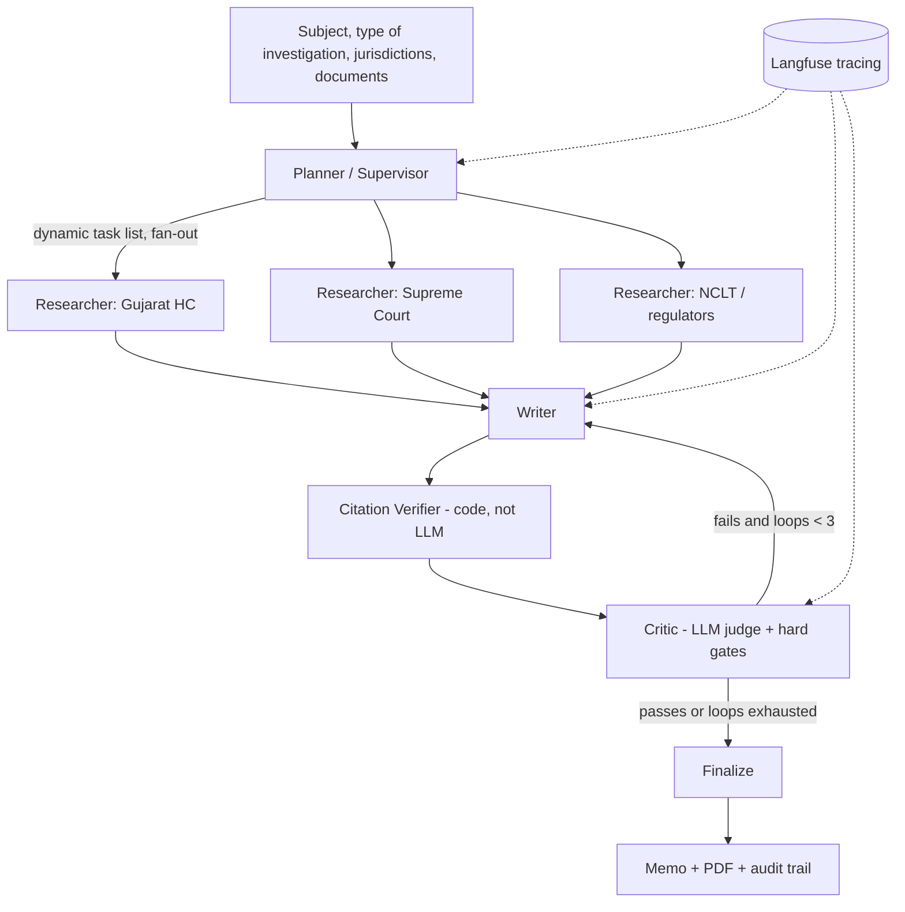

# ⚖️ LegalSaathi

**LegalSaathi** is a multi-agent AI legal companion for Indian law, built with LangGraph, Groq, Tavily and Streamlit. Its central idea:
**nothing the AI says is trusted until code has checked it against a real source.**

> Lawyers have been sanctioned for filing briefs with hallucinated citations. Every feature here has a
> deterministic (non-AI) check that removes or flags what it cannot ground.

## Features

| Service | What it does | The safety check |
|---|---|---|
| 📝 **Legal memo** | Due-diligence memo on a company, property or dispute. Planner → parallel per-jurisdiction researchers → writer → verifier → critic loop | Every cited case is matched to a retrieved trusted source and an independent lookup; the critic loop repeats until the bar is met |
| 📄 **Document analysis** | Upload an agreement: summary, important clauses with concern ratings, possibly-missing items, questions for your lawyer, and Q&A | A clause is kept only if the words it quotes really appear in the document |
| 🔎 **Case and law search** | Ask a legal question, get judgments and statutes with summaries and links | Cases that cannot be matched to a real source are dropped; the rest are marked Verified or Unverified |
| ✍️ **Drafting** | Agreement to Sell, Sale Deed, Rent Agreement, Gift Deed, Power of Attorney as PDF and Word | Fixed templates (not free AI writing), amounts checked and written in words, validation and legal notes on every draft |

Two modes on the first screen: **Lawyer** (professional wording) and **Individual** (plain English, with
"Questions to ask your lawyer").

## Architecture (memo pipeline)



### How a citation is verified
1. The cited source must have been **actually retrieved** in this run.
2. It must come from a **trusted legal domain** (`mw_config.INDIAN_LEGAL_DOMAINS`), not a blog or an upload.
3. The case name must **appear in that source** (word-overlap ≥ 70%).
4. An **independent lookup** (Indian Kanoon API if configured, otherwise Tavily on trusted domains) must return a matching title.

Status per case: `verified`, `unverified` (grounded but not confirmed) or `failed` (dropped).
A memo is **APPROVED** only if all cases are verified, every fact has a real source, and the critic average is ≥ 4.0
with no dimension below 3. After 3 revisions it is marked **NEEDS HUMAN REVIEW**.

### Auditability
The **Audit trail** tab / JSON lists each claim with the source URL(s) behind it. With Langfuse keys set, every agent
run, prompt and output is traced too.

## Quick start (local)

```bash
git clone <your-repo-url>
cd <your-repo>
python -m venv .venv
source .venv/bin/activate        # Windows: .venv\Scripts\activate
pip install -r requirements.txt
cp .env.example .env             # then paste your keys into .env
streamlit run app.py
```

Keys: **Groq** (free, console.groq.com) and **Tavily** (free tier, tavily.com). Put them in `.env` (local) or Streamlit
Secrets (deployed). **Visitors never see or enter keys**; the app uses yours. Models are picked automatically from what your
Groq key can use. For testing, set `ADMIN_MODE=1` to reveal key boxes and model settings (leave it off for visitors).

Run the tests: `pip install pytest && pytest -q` (the tests use fake AI responses, so they need no keys or network).

## Deploy on Streamlit Community Cloud (free)
1. Put all files in the **root** of a GitHub repo (the only folder is `.streamlit/` for the theme), main file `app.py`.
2. In **Settings → Secrets** add:
```toml
GROQ_API_KEY = "..."
TAVILY_API_KEY = "..."
```
Optional:
```toml
ADMIN_MODE = "0"                      # "1" shows key boxes and model settings (owner only)
APP_ACCESS_CODE = "choose-a-code"     # visitors must enter it (leave out for an open demo)
MAX_RUNS_PER_DAY = "20"               # daily cap that protects your free-tier quota
INDIANKANOON_API_TOKEN = "..."
LANGFUSE_PUBLIC_KEY = "..."
LANGFUSE_SECRET_KEY = "..."
LANGFUSE_HOST = "https://cloud.langfuse.com"
```

## Look and feel
Dark ink and gold theme with serif headings. The base theme lives in `.streamlit/config.toml`; the rest is CSS in `ui_theme.py`.
Without the config file the app still works but uses Streamlit's default colours for some widgets.

## Files (all in the repo root, plus `.streamlit/config.toml`)

```
app.py              entry point: sign-in gate, mode choice, service menu, settings
ui_memo.py          screen: legal memo
ui_docs.py          screen: document analysis
ui_search.py        screen: case and law search
ui_draft.py         screen: drafting
ui_common.py        shared UI helpers
ui_theme.py         dark + gold styling, hero, top bar
mw_config.py        limits, trusted domains, model preferences, document checklists
mw_state.py         Pydantic schemas + LangGraph state
mw_llm.py           Groq model + structured-output helper
mw_tools.py         Tavily / Indian Kanoon search, document text extraction
mw_matching.py      case-name and quote matching (no AI)
mw_planner.py       memo: supervisor / dynamic task list
mw_researcher.py    memo: parallel per-jurisdiction worker
mw_writer.py        memo: drafting with source ids
mw_verifier.py      citation verification (no AI)
mw_critic.py        memo: LLM judge + hard gates
mw_graph.py         LangGraph wiring and reflection loop
mw_audit.py         claim -> source map
mw_pdf_export.py    memo PDF
mw_docanalysis.py   document analysis agent
mw_casesearch.py    case search: research + verification agents
mw_drafting.py      drafting templates, validation, amount-in-words
mw_docexport.py     PDF / Word export for drafts and analysis
mw_tracing.py       Langfuse integration
test_verifier.py    planted fake citations must be caught
test_functions.py   tests for analysis, search and drafting
requirements.txt  .env.example  .gitignore  README.md
```

## Scope compared with the full product spec

| Spec item | Status |
|---|---|
| Lawyer / Individual entry screen | Built |
| Function 1: Legal memo (company / property / litigation types) | Built |
| Function 2: Document analysis | Built (text-based PDF, Word, TXT; no OCR for scanned pages) |
| Function 3: Property investigation | Partly: uploads + public sources only, no land-record portals |
| Function 4: Legal research and case search | Built |
| Function 5: Document drafting | Built (5 document types, fixed templates) |
| Login, saved history, follow-up chat on memos | Planned (document Q&A is built) |

## Known limitations
- Only **publicly searchable** sources. eCourts, MCA21, land records and many High Court portals need captchas or logins
  and are not queried directly. **No result does not mean no litigation.**
- Verification confirms a case exists and matches a source. It does not prove the legal reasoning is right.
- Document analysis reads at most about 40,000 characters (8 chunks) of a document; longer ones are cut and the result says so.
  Scanned PDFs (photos of pages) cannot be read.
- Drafts are templates. Stamp duty, registration and local rules differ by State. A lawyer must review every draft.
- Groq's free tier has token and rate limits: use 1-3 jurisdictions, short documents, and keep `MAX_RUNS_PER_DAY` low.
- Open models can be weaker at legal reasoning than frontier models, which is why the code-based checks exist.
- Text you enter or upload is sent to Groq and Tavily. Do not upload Aadhaar, PAN or bank details.
- PDF fonts: ₹ is written as "Rs." in exports.

## Troubleshooting
| Problem | Fix |
|---|---|
| `ModuleNotFoundError: mw_...` or `ui_...` | A file is missing from the repo root. Compare your file list with the one above |
| `model_not_found` / 404 | Sidebar → *Advanced settings* → pick another model |
| 429 / rate limit | Wait a minute, choose fewer courts, or analyse a shorter document |
| Memo ends `NEEDS HUMAN REVIEW` | Expected when sources are thin; open *Source checks* for the reason |

*Not legal advice. Prepared with AI assistance; review by a qualified lawyer is required.*
